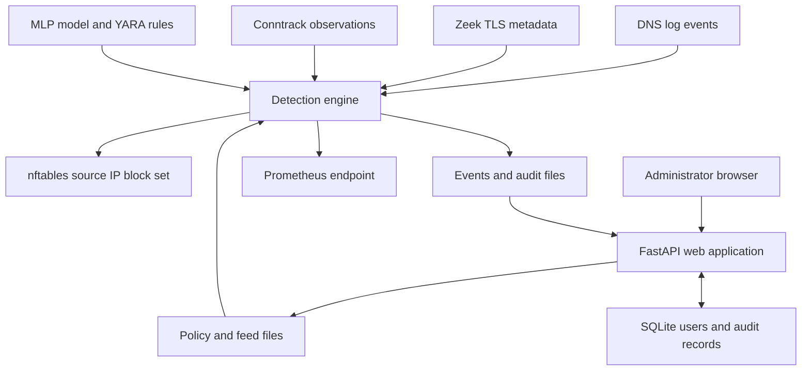

# MiniFW-AI technical reference

For C18's current connection-count behavior and explicit dashboard save/apply procedure,
see the [4 November acceptance report](2026-11-04_acceptance-minifwai-report.md).
The older snapshot below includes a connection-frequency hard gate retired in C17.

MiniFW-AI analyzes DNS names, TLS metadata, and connection observations on a Linux gateway, then uses nftables to block forwarded traffic from clients that meet its detection criteria. A separate FastAPI application provides the administration interface.

This document describes the working tree based on revision `8506eb3f`, reviewed on 2026-10-26. The package version in `pyproject.toml` and the default in `scripts/build_deb.sh` target `2.2.9`; that release must be published before its release links work. The web application's OpenAPI metadata separately reports `1.0.0`.

**Before deployment:** live enforcement requires Linux, nftables privileges, and traffic routed through the gateway. `DEV_MODE=1` bypasses authentication. Demo events, a healthy web endpoint, and a protection-state label do not prove that packets are being blocked. Read the [operating limits](#operating-limits) before relying on degraded operation.

## Contents

- [System architecture](#system-architecture)
- [Run a local interface preview](#run-a-local-interface-preview)
- [Install on a Linux gateway](#install-on-a-linux-gateway)
- [Configure the deployment](#configure-the-deployment)
- [Understand detection and enforcement](#understand-detection-and-enforcement)
- [Use the administration API](#use-the-administration-api)
- [Inspect stored data and metrics](#inspect-stored-data-and-metrics)
- [Operate and recover the system](#operate-and-recover-the-system)
- [Develop and validate changes](#develop-and-validate-changes)
- [Operating limits](#operating-limits)
- [Source evidence](#source-evidence)

## System architecture

The engine and web application are separate processes sharing files and a deployment directory. The web application does not send configuration changes to a daemon control API.

| Component | Entry point / location | Responsibilities |
| --- | --- | --- |
| Detection engine | `python -m minifw_ai`, with `app/` on `PYTHONPATH` | Collect telemetry, apply detection rules, write events, update nftables |
| Web administration | `app.web.app:app` from the repository root; the service uses `web.app:app` | Render Jinja2/AdminLTE pages, authenticate users, manage configuration and reports |
| Policy and feeds | `config/` | Segments, scoring weights, enforcement settings, domain/IP/ASN lists |
| User database | `minifw.db` at the application root | SQLAlchemy-backed SQLite users and administrative audit records |
| Runtime evidence | `logs/` | Detection events, engine/authentication audit records, flow features, protection state |
| Kernel enforcement | `inet minifw`, set `minifw_block_v4` by default | Expiring IPv4 source-address blocks in the forwarding path |



The event loop is driven by the DNS iterator. On each iteration it attempts to read up to three Zeek events and five conntrack observations, updates telemetry health, and then evaluates a real DNS event. Collector iteration can block; these are not independent asynchronous pipelines.

The default nftables rule is equivalent to `ip saddr @minifw_block_v4 drop` in a forward-hook chain with an accept policy. It blocks the client's forwarded IPv4 traffic, not just the triggering domain. It does not establish routing, NAT, or a complete host firewall. Configure gateway interfaces and forwarding independently, and verify that client traffic traverses this network namespace.

Sources: [engine](../app/minifw_ai/main.py), [enforcement](../app/minifw_ai/enforce.py), [web application](../app/web/app.py).

## Run a local interface preview

Use Python 3.12 to match CI. From the repository root, these Bash commands install the pinned dependencies and serve the interface on loopback:

```bash
python3.12 -m venv .venv
source .venv/bin/activate
python -m pip install -r requirements.txt
export PYTHONPATH="$PWD/app"
export PRODUCT_MODE=minifw_establishment
export MINIFW_POLICY="$PWD/config/modes/minifw_establishment/policy.json"
export MINIFW_LOG="$PWD/logs/events.jsonl"
export MINIFW_AUDIT_LOG="$PWD/logs/audit.jsonl"
export MINIFW_SECRET_KEY="$(python -c 'import secrets; print(secrets.token_hex(32))')"
DEV_MODE=1 python -m uvicorn app.web.app:app --host 127.0.0.1 --port 8443
```

Open `http://127.0.0.1:8443/admin/`. This serves HTTP, creates missing SQLite tables, and injects a synthetic super-admin through development mode. It does not start the engine or provide live network protection. Interface changes still write local configuration, so use a disposable checkout for experimentation. Stop with Ctrl+C.

For authenticated operation, use the packaged installation below. `scripts/create_admin.py` creates an account through the basic user service; it does not perform the package installer's explicit promotion to `super_admin`. Its filename does not guarantee administrator privileges.

The explicit Uvicorn command also avoids relying on `run_web.py`: that launcher binds to all interfaces, enables reload, and imports `python-dotenv`, which is not listed in `requirements.txt`.

## Install on a Linux gateway

### Prepare and install the package

The packaging script targets Debian-style Linux systems and `amd64`. It declares Python 3.10 or newer; CI uses Python 3.12. Existing deployment guidance targets Ubuntu 22.04+ and Debian 12+. Validate the actual OS, dependencies, kernel, and NIC topology on the intended appliance.

Use a dedicated gateway or test VM: package post-installation also disables CUPS and modifies an existing Grafana configuration to bind to localhost. Installation starts both MiniFW services.

For a source build on Linux, run from the repository root:

```bash
bash scripts/build_deb.sh establishment 2.2.9
sudo apt-get update
sudo apt-get install python3 python3-venv nftables conntrack openssl dnsmasq
sudo apt-get install ./build/minifw-ai_2.2.9-establishment_amd64.deb
```

The build requires `dpkg-deb`, `models/mlp_model.pkl`, and the rules in `yara_rules/`. Substitute another supported sector in the command and filename as needed. The script reads the sector from its first argument and an optional `MAJOR.MINOR.PATCH` version from its second argument. The release workflow passes the tag version to this script.

For downloaded packages, follow [release verification](release-verification.md) first. Post-installation runs `pip install -r requirements.txt`; the `.deb` alone is not a self-contained offline installer. Offline deployment needs an independently prepared dependency source or the project's staged demo kit. The package includes the DNS logging and uninstall helper scripts; the release installer runs DNS setup after the package post-installation starts both services.

Post-installation creates `/opt/minifw_ai/venv`, generates secrets in `/etc/minifw/minifw.env` if absent, creates a self-signed TLS certificate, initializes the database, and creates `admin` if absent. A newly created account receives `super_admin` and a mandatory password change. Existing credentials are preserved; the bootstrap password file is not synchronized with later account password changes.

### Align configuration and telemetry

Inspect the installed units, because packaging modifies the repository templates:

```bash
sudo systemctl cat minifw-ai minifw-ai-web
sudoedit /etc/minifw/minifw.env
```

Preserve the generated secret/password entries. For an establishment deployment, add or update these non-secret entries so both services use the same policy, identity, and event file:

```dotenv
PRODUCT_MODE=minifw_establishment
MINIFW_SECTOR=establishment
MINIFW_POLICY=/opt/minifw_ai/config/modes/minifw_establishment/policy.json
MINIFW_FEEDS=/opt/minifw_ai/config/feeds
MINIFW_LOG=/opt/minifw_ai/logs/events.jsonl
MINIFW_AUDIT_LOG=/opt/minifw_ai/logs/audit.jsonl
DEV_MODE=0
DEMO_MODE=0
MINIFW_DISABLE_FLOWS=0
```

Both packaged services load this file. The raw engine template acquires its `EnvironmentFile` during package installation. Editing a repository `.env` does not configure systemd services.

Configure dnsmasq to log queries from client networks. These directives belong in the deployment's dnsmasq configuration; match the path to `collectors.dnsmasq_log_path` in the active policy:

```ini
log-queries
log-facility=/var/log/dnsmasq.log
```

```bash
sudo dnsmasq --test
sudo systemctl restart dnsmasq
sudo systemctl restart minifw-ai minifw-ai-web
```

Clients must use the observed DNS service. If using Zeek, supply its SSL log at the configured path and verify it receives traffic from the same clients. If Zeek is intentionally absent, set `collectors.use_zeek_sni` to `false` and restart; a configured collector waiting for data can stall the shared event loop.

### Verify the installation

```bash
systemctl status minifw-ai minifw-ai-web --no-pager
sudo journalctl -u minifw-ai -n 100 --no-pager
sudo nft list table inet minifw
sudo nft list set inet minifw minifw_block_v4
curl --fail --silent http://127.0.0.1:9090/metrics
curl --insecure --fail --silent https://127.0.0.1:8443/health/
```

The final command uses `--insecure` only for a local check against the generated self-signed certificate. Configure certificate trust for regular administration. The packaged web service binds to `127.0.0.1:8443` with TLS; remote administration needs a deliberately configured access path such as an SSH tunnel.

Log in as `admin` using the generated password and complete the password change. Verify that a controlled DNS query produces a fresh event, then validate a blocking scenario on an isolated client. Inspect both the nftables element and actual packet behavior. `/health/` alone checks only the web response.

## Configure the deployment

### Choose a sector

Sector identity is resolved once per process in this order: `PRODUCT_MODE`, `MINIFW_SECTOR`, production sector-lock JSON, then the repository fallback lock file. A missing or invalid identity raises a configuration error. Changing identity requires restarting the affected processes; the UI cannot change the singleton at runtime.

| Product mode | Sector value / package argument | Monitor adjustment | Block adjustment |
| --- | --- | ---: | ---: |
| `minifw_establishment` | `establishment` | 0 | 0 |
| `minifw_hospital` | `hospital` | -20 | -5 |
| `minifw_school` | `education` | -10 | -10 |
| `minifw_financial` | `finance` | -5 | -5 |
| `minifw_government` | `government` | -10 | -10 |
| `minifw_legal` | `legal` | -10 | 0 |

These adjustments are added to the chosen segment thresholds, each floored at 10. They also apply with sector-specific policy files. For example, hospital mode with the **base policy's** default monitor/block values of 60/90 evaluates at 40/85. Check the selected policy before calculating effective thresholds.

`PRODUCT_MODE` selects the sector, but `main.run()` reads `MINIFW_POLICY` or its fixed default. Set `MINIFW_POLICY` explicitly rather than assuming mode selection automatically changes every component's path. The package builder does this for the engine; align the web service as shown above.

Sources: [mode registry](../app/minifw_ai/mode_loader.py), [sector lock](../app/minifw_ai/sector_lock.py), [sector adjustments](../app/minifw_ai/sector_config.py).

### Environment reference

Paths below are engine defaults unless identified otherwise. Supply the same paths to both processes where applicable.

| Variable | Default / requirement | Effect |
| --- | --- | --- |
| `PRODUCT_MODE` | Optional if another valid sector source exists | Canonical deployment identity |
| `MINIFW_SECTOR` | No implicit sector in the lock loader | Legacy sector selection |
| `MINIFW_SECTOR_LOCK_FILE` | `/opt/minifw_ai/config/sector_lock.json` | Production lock-file path |
| `MINIFW_SECRET_KEY` | Required by web token service | Signs HS256 login tokens; keep stable across web restarts |
| `MINIFW_ADMIN_PASSWORD` | Required for account bootstrap | Does not update an existing user's password |
| `MINIFW_POLICY` | `/opt/minifw_ai/config/policy.json` | Policy JSON loaded at startup |
| `MINIFW_FEEDS` | `/opt/minifw_ai/config/feeds` | Engine feed directory |
| `MINIFW_LOG` | `/opt/minifw_ai/logs/events.jsonl` | Detection events; web otherwise falls back to project `logs/` |
| `MINIFW_FLOW_RECORDS` | `/opt/minifw_ai/logs/flow_records.jsonl` | Exported flow features |
| `MINIFW_AUDIT_LOG` | Set explicitly for deployment | Engine/authentication audit output |
| `MINIFW_MLP_MODEL` | Unset disables model loading | Trusted serialized model path |
| `MINIFW_MLP_THRESHOLD` | `0.5` | MLP probability threshold |
| `MINIFW_YARA_RULES` | Unset disables rule loading | Rules directory |
| `MINIFW_DNS_SOURCE` | `file` | `file`, `journald`, `udp`, or `none` |
| `MINIFW_JOURNALD_UNIT` | `systemd-resolved` | Journald DNS unit |
| `MINIFW_DNS_UDP_PORT` | `5514` | UDP log ingestion port; not a DNS resolver port |
| `MINIFW_CONNTRACK_PATH` | `/proc/net/nf_conntrack` | Conntrack source; collector supports CLI fallback |
| `MINIFW_DISABLE_FLOWS` | `0` | `1` skips conntrack collection |
| `MINIFW_MAX_FLOWS` | `20000` | Flow tracker capacity |
| `MINIFW_FLOW_FREQ_WINDOW_SEC` | `60` | Observation-frequency window |
| `MINIFW_FLOW_FREQ_THRESHOLD` | `200` | Hard-gate frequency threshold |
| `MINIFW_FLOW_PKT_SIZE_ESTIMATE` | `1500` | Estimated bytes per conntrack observation |
| `MINIFW_PORT_SCAN_THRESHOLD` | `15` | Distinct destination-port threshold |
| `MINIFW_TUNNEL_SUBDOMAIN_THRESHOLD` | `20` | Sustained DNS-tunnel subdomain threshold |
| `MINIFW_ASN_PREFIXES` | `asn_prefixes.txt` under feed directory | CIDR-to-ASN mapping |
| `MINIFW_TOR_EXITS` | `tor_exit_nodes.txt` under feed directory | Additional deny IPs for applicable sectors |
| `PROMETHEUS_PORT` | `9090` | Metrics port on loopback |
| `AI_ENABLED` | True | Initial protection-state input, not a permanent AI-disable switch |
| `DEGRADED_MODE` | `0` | `1` selects initial baseline and substitutes empty DNS events |
| `DEV_MODE` | `0` | `1` bypasses web authentication |
| `DEMO_MODE` | Off | Engine value `1` skips initial firewall setup; web value `attack_simulation` generates events |

`.env.example` enables development mode. Do not copy it unchanged into production. Engine feed overrides also do not guarantee all web writers use that path: the deny-domain writer constructs project-relative `config/feeds/deny_domains.txt`. Keep the packaged shared feed location unless the relevant writers have been checked.

### Policy and feeds

| Policy section | Purpose | Base policy example |
| --- | --- | --- |
| `segments` | Monitor/block thresholds | Default 60/90; internal 50/85; guest 40/70 |
| `segment_subnets` | CIDR membership | First matching segment wins; otherwise `default` |
| `features` | Scoring weights | DNS 40, SNI 35, ASN 15, deny IP 15, burst 10, MLP 30, YARA 35 |
| `enforcement` | Table, chain, set, expiry | `inet minifw`, `forward`, `minifw_block_v4`, 86400 seconds |
| `collectors` | DNS/Zeek log paths and Zeek enable flag | `/var/log/dnsmasq.log`, `/var/log/zeek/ssl.log`, enabled |
| `burst` | DNS queries per minute thresholds | Monitor 120, block 240 |
| `iomt_subnets` | Hospital medical-device networks | Replace sample ranges with actual networks |

Feeds contain one entry per line; blank lines and lines beginning with `#` are ignored. Domains use `fnmatch` patterns: `*.example.test` and `example.test` are distinct patterns. IP/ASN deny checks use exact string membership. Domain allow entries suppress domain/SNI deny contributions, not hard gates or all other signals. Sector feeds are appended at startup.

**Restart the engine to apply changes.** `Policy` loads JSON in its constructor; `FeedMatcher` loads lists during construction/sector initialization. Saving through the UI does not reload these objects. Back up the file, validate JSON, then restart:

```bash
# Establishment example; use the actual MINIFW_POLICY path for your deployment.
python3 -m json.tool /opt/minifw_ai/config/modes/minifw_establishment/policy.json >/dev/null
sudo systemctl restart minifw-ai
sudo journalctl -u minifw-ai -n 50 --no-pager
```

Syntax validation does not establish semantic correctness. Keep monitor thresholds below block thresholds, check subnet ordering, and account for sector adjustments.

## Understand detection and enforcement

### Decision pipeline

For each real DNS event, the engine selects a segment, adjusts thresholds, and evaluates:

1. Domain/latest cached SNI matches against allow/deny patterns.
2. Client-IP ASN and client-IP deny membership, including loaded Tor exits.
3. DNS query frequency, distinct destination ports, and tracked flows.
4. Hard gates: excessive flow frequency, port scan, high estimated PPS, burst size, or bot-like packet/timing characteristics.
5. DNS-tunneling heuristics and sustained unique-subdomain activity.
6. MLP inference on a qualifying flow and YARA matching against the UTF-8 `domain`/`sni` string, when available and AI-enabled.

A hard gate immediately returns score 100 and `block`. Otherwise the engine sums feed/burst weights, the tunnel score, and these weighted contributions, clamping the result to 0–100:

```text
MLP contribution  = floor(mlp_score  * mlp_weight  / 100)
YARA contribution = floor(yara_score * yara_weight / 100)

score >= block threshold   -> block
score >= monitor threshold -> monitor
otherwise                  -> allow
```

Only an MLP result classified as suspicious contributes its probability-derived score. YARA uses the highest matched severity: low 25, medium 50, high 75, critical 100 before weighting. Finance/government rule evaluators run after base scoring and can upgrade the action.

Under establishment's **base default segment**, a denied DNS name alone scores 40 and is allowed. DNS plus denied SNI scores 75 and is monitored; adding a denied ASN yields 90 and blocks. A deny-list match is not synonymous with an immediate block.

Both DNS burst thresholds currently produce the same single burst contribution. Hard-gate overrides are separate. Conntrack-derived packet sizes and timings are estimates from observations, not packet-capture measurements.

### Protection states

`BASELINE_PROTECTION` disables MLP/YARA initialization. For real DNS events, feed scoring, tunneling checks, sector rules, and hard gates still run. `AI_ENHANCED_PROTECTION` permits loading optional model/rules; its name does not guarantee successful loading.

| State setting | Default | Meaning |
| --- | ---: | --- |
| `MINIFW_STATE_CHECK_INTERVAL` | 30 seconds | Minimum time between health evaluations |
| `MINIFW_TELEMETRY_TIMEOUT` | 60 seconds | Maximum DNS-event age for healthy telemetry |
| `MINIFW_STATE_UPGRADE_THRESHOLD` | 3 | Consecutive healthy checks before upgrade |
| `MINIFW_STATE_DOWNGRADE_THRESHOLD` | 2 | Consecutive unhealthy checks before downgrade |

State restored from `/opt/minifw_ai/logs/deployment_state.json` can override the initial environment-derived choice. Later transitions can re-enable AI even if `AI_ENABLED=0` selected initial baseline. State checks occur inside the collection loop, so blocking collectors can delay them.

**DNS-disabled operation has a material limitation:** `pump_flows()` updates trackers, but hard-gate evaluation follows the branch skipping empty DNS events. With `MINIFW_DNS_SOURCE=none` or `DEGRADED_MODE=1`, those iterations do not evaluate new hard-gate blocks. Existing kernel elements can remain until expiry; this is not guaranteed fail-closed fallback protection.

## Use the administration API

### Authentication

`POST /auth/login` accepts form fields `username` and `password`. Success sets an HttpOnly `access_token` cookie and returns a 303 redirect. Accounts with 2FA enabled proceed through `/auth/2fa` and submit `totp_code` to `POST /auth/2fa/verify`. These routes verify existing TOTP enrollment; this reference does not assume a public enrollment API.

Middleware reads the cookie, not `Authorization: Bearer`. JWTs use HS256 and expire after 60 minutes by default. A first-login password flag redirects to `/auth/change-password`. `GET /auth/logout` clears browser cookies; it does not revoke all previously issued tokens server-side.

RBAC defines `super_admin`, `admin`, `operator`, `auditor`, and `viewer`. Endpoint/controller checks determine actual privileges. User creation requires `super_admin`; the request validator accepts four roles and excludes `auditor`, although the model defines it.

Send `Accept: application/json` for API reads. Unauthenticated HTML requests redirect to login; JSON requests receive 401. Disabled accounts/insufficient permissions can produce 403, malformed request bodies 422, and application validation 400. Login errors render HTML rather than JSON token responses.

### Endpoint reference

Routes below require authentication unless marked public; mutations can require additional permissions. The current FastAPI configuration exposes `/docs` and `/openapi.json`. Use that generated schema for complete request fields, and source for cookie authentication behavior.

| Method and path | Input / use | Output or effect |
| --- | --- | --- |
| `GET /health/` (public) | Web liveness | `{"status":"ok"}` |
| `GET /status/` (public) | Static response | `{"policy_loaded":true,"events_active":true}`; not daemon readiness |
| `GET /admin/api/auth/current-user` | Current session | User information |
| `GET /admin/api/events` | `draw`, `start`, `length`, `search_value`, `order_column`, `order_dir` | DataTables response; length clamped to 1–500 |
| `GET /admin/api/events/download` | `fmt=xlsx\|csv\|pdf`, `action_filter=all\|block\|monitor\|allow` | Event report |
| `GET /admin/api/block-rate` | Recent events | Twelve five-second buckets over the last minute |
| `GET /admin/api/live-blocks` | Dashboard block view | Recent block information; verify kernel independently |
| `GET /admin/api/kernel-proof` | Enforcement evidence | Cached check; can fall back to an audit sentinel |
| `GET /admin/api/sector-lock` | Deployment identity | Sector, mode, lock status, selected flags |
| `GET /admin/api/iomt-alerts` | Hospital event view | IoMT alert data |
| `GET /admin/allow-domain`, `/admin/deny-domain`, `/admin/deny-ip`, `/admin/deny-asn` | Browser navigation | HTML feed management pages |
| `POST` on those four feed paths | JSON `domain`, `ip`, or `asn` | Add entry |
| `PUT` on those four feed paths | JSON `old`, `new` | Replace entry |
| `DELETE` on those four feed paths | JSON `domain`, `ip`, or `asn` | Delete entry |
| `POST /admin/policy/segment` | `segment_name`, `block_threshold`, `monitor_threshold` | Save thresholds |
| `DELETE /admin/policy/segment/{segment_name}` | Segment name | Delete segment |
| `POST /admin/policy/segment/subnets` | `segment_name`, `subnets` | Save CIDRs |
| `POST /admin/policy/features` | DNS, SNI, ASN, burst weights | Save supported weights |
| `POST /admin/policy/enforcement` | Set name, timeout, table family, chain | Save supported enforcement settings |
| `POST /admin/policy/collectors` | DNS/Zeek paths, Zeek enable flag | Save collectors |
| `POST /admin/policy/burst` | Monitor/block query rates | Save burst settings |
| `GET`, `POST /admin/api/users` | List/create users | User records |
| `PUT`, `DELETE /admin/api/users/{user_id}` | User ID and applicable fields | Update/delete user |
| `PUT /admin/api/users/{user_id}/password` | User ID and password body | Change password |
| `GET /admin/api/audit/logs`, `/admin/api/audit/statistics`, `/admin/api/audit/export` | Audit queries | Administrative audit data/export |

Read-only example for the browser developer console after signing in on the same origin:

```javascript
const response = await fetch('/admin/api/events?start=0&length=20&order_dir=desc', {
  credentials: 'same-origin',
  headers: { Accept: 'application/json' }
});
if (!response.ok) throw new Error(`Event request failed: ${response.status}`);
console.log(await response.json());
```

Example JSON body for `POST /admin/policy/segment` (requires permission and changes configuration):

```json
{
  "segment_name": "guest",
  "block_threshold": 70,
  "monitor_threshold": 40
}
```

Restart the engine after successful policy/feed mutations. A successful save does not confirm adoption by the running engine.

Sources: [registered routers](../app/web/app.py), [authentication](../app/web/routers/auth.py), [admin routes/schemas](../app/web/routers/admin.py), [middleware](../app/middleware/auth_middleware.py).

## Inspect stored data and metrics

### Files and records

| Artifact | Contents | Operational meaning |
| --- | --- | --- |
| `minifw.db` | `users` and administrative `audit_logs` | Fixed path relative to `app/database.py`, not a database URL environment override |
| `events.jsonl` | One serialized `Event` per line | Detection decisions for the dashboard |
| `audit.jsonl` | Lifecycle, firewall initialization, blocks, authentication | Separate from SQLite administrative audit records |
| `flow_records.jsonl` | Flow identity, 24-feature vector, decision/AI fields, labels | Every 100 processed DNS events, for flows with at least five observations; label initially null |
| `deployment_state.json` | Current state and recent transitions | Up to 100 transitions; fixed production path by default |
| `models/mlp_model.pkl` | Serialized trained model | Load trusted artifacts compatible with pinned ML dependencies |
| `yara_rules/*.yar` | Patterns | Rules must compile before YARA becomes active |

Illustrative raw event matching the `Event` dataclass, rather than the dashboard's transformed display fields:

```json
{
  "ts": "2026-10-23T10:00:00+00:00",
  "segment": "default",
  "client_ip": "192.0.2.10",
  "domain": "suspicious.example.test",
  "action": "monitor",
  "score": 75,
  "reasons": ["dns_denied_domain", "tls_sni_denied_domain"],
  "sector": "establishment",
  "severity": "info",
  "trace_id": "A1B2C3D4",
  "decision_owner": "Policy Engine",
  "student_flagged": false,
  "vpn_block_enforced": false,
  "audit_mode": false
}
```

Hospital mode redacts event domains and flow-record domains/SNI. Block auditing separately receives the original domain, and IoMT journal messages can include it. Redaction is not universal. Sector labels/flags do not establish regulatory compliance or automatic retention enforcement.

### Metrics

The engine starts a Prometheus-compatible endpoint on `127.0.0.1:9090` by default, before the rest of initialization. Listener errors are logged; endpoint availability alone does not prove readiness.

| Metric | Type | Interpretation |
| --- | --- | --- |
| `minifw_ai_flows_processed_total` | Counter | Incremented per recorded decision, despite the name |
| `minifw_ai_decisions_total{decision=...}` | Counter | Decisions by `allow`, `monitor`, `block` |
| `minifw_ai_hard_gate_blocks_total{gate_type=...}` | Counter | Recorded hard-gate triggers |
| `minifw_ai_threat_score` | Histogram | Recorded score distribution |
| `minifw_ai_active_flows` | Gauge | Tracker size when updated |
| `minifw_ai_active_blocks_total` | Gauge | Incremented on block decisions; not reconciled with unique live kernel elements or expiry |

The module also declares MLP/YARA latency histograms and a model-training timestamp gauge. Declaration alone does not demonstrate runtime population. Use kernel inspection for live blocks and fresh events plus service logs for processing health.

## Operate and recover the system

### Troubleshooting

| Symptom | Check | Next action |
| --- | --- | --- |
| Web responds but events stop | DNS freshness, Zeek availability, conntrack iterator, engine journal | Restore telemetry; disable unused Zeek collection explicitly and restart |
| Policy edit has no effect | Engine/web `MINIFW_POLICY`, restart time | Align paths and restart engine |
| Wrong dashboard sector | Both processes' `PRODUCT_MODE` and environment files | Correct settings and restart both |
| No MLP/YARA contribution | Startup messages and artifact paths | Fix missing dependencies/files; state name alone is insufficient |
| Conntrack procfs missing | Kernel module and privileged `conntrack -L` availability | Configure CLI fallback and verify observations |
| Block event but traffic passes | Set, chain, namespace, route, source IP | Verify actual forwarding path |
| Engine exits during startup | Journal sector/firewall errors | Fix configuration/privileges; normal-return fatal paths may not trigger `Restart=on-failure` |
| Authenticated request redirects | Password-change flag, cookie expiry, Accept header | Complete password change or log in again; request JSON for API errors |
| Missing secret at startup | Actual web-process environment | Restore deployment secret and restart web |
| Metrics port unavailable | Startup logs and conflicts | Resolve conflict or set `PROMETHEUS_PORT` |

Run `systemctl daemon-reload` after unit/drop-in changes, then restart the affected service. Stopping the engine does not remove its nftables table; existing entries may block until expiry or explicit removal.

### Back up and restore

The backup script archives configuration, rules, models, SQLite, secrets, TLS material, both unit files, and an nftables ruleset export. Logs are archived separately. Application code/virtualenv, systemd drop-ins, and dnsmasq configuration are not explicitly included.

Because it copies SQLite directly, stop the web service to avoid its writes during backup. Protect archives because they contain secrets:

```bash
sudo systemctl stop minifw-ai-web
sudo bash -c 'umask 077; bash /opt/minifw_ai/scripts/backup.sh'
sudo systemctl start minifw-ai-web
```

If backup fails, still restart web and investigate before trusting the archive. Engine log writing continues, so logs are not a synchronized snapshot. Copy verified archives to protected storage away from the appliance; retain the matching package and separately managed host configuration.

Restore in a maintenance window on a host with matching application/dependencies installed. The script stops services, extracts files at `/`, restores an nftables export when found, and starts services. The export can contain other firewall managers' rules; review the exact archive and rules first.

From Bash, select a trusted archive explicitly:

```bash
read -r -p "Backup archive path: " MINIFW_BACKUP_ARCHIVE
sudo tar -tzf "$MINIFW_BACKUP_ARCHIVE"
sudo bash /opt/minifw_ai/scripts/restore.sh "$MINIFW_BACKUP_ARCHIVE"
sudo systemctl status minifw-ai minifw-ai-web --no-pager
sudo nft list table inet minifw
```

Recheck login, policy/sector alignment, telemetry, and controlled enforcement afterward. See [rollback procedures](rollback.md) for removal/recovery context; destructive package removal is separate from restoring data.

### Database changes

Web startup calls SQLAlchemy `create_all`, which creates missing tables but does not migrate existing columns. Review `scripts/migrate_database.py` before migrating an old database: it defaults to `minifw.db` in the current directory, copies a backup, and promotes existing null/`viewer` roles to `super_admin`. This changes privileges as well as schema. Plan migrations with writers stopped and verify resulting roles; do not use that script as routine startup.

## Develop and validate changes

Code follows router → controller → service organization. Engine modules are in `app/minifw_ai/`; database models are in `app/models/`. Configuration, parsing, decision logic, and kernel enforcement are separate parts of the pipeline.

From a repository-root virtual environment with `requirements.txt` installed, the main CI commands are:

```bash
python -m pip install pytest
python -m pytest testing/ -m "not integration" -v
bash testing/test_install_sh.sh
```

CI also runs `shellcheck install.sh`. Root/network integration tests belong on an isolated Linux testbed. Scoring changes need threshold-boundary and hard-gate-precedence coverage; collectors need real telemetry validation as well as parser tests. Mocked enforcement tests do not validate a host's routing topology.

See [DEVELOPER.md](../DEVELOPER.md) for workflow and [testing/README.md](../testing/README.md) for utilities. Update this reference when changing environment names, route schemas, model features, or package scripts.

## Operating limits

- **IPv4 forwarding:** the default set uses `ipv4_addr`; its rule matches source addresses. It does not provide IPv6 or host input/output protection.
- **Telemetry coupling:** blocking collector reads can delay scoring/state checks. DNS-disabled iterations skip hard gates; existing kernel entries still expire.
- **Configuration adoption:** UI saves update files. Restart the engine to reload them, or displayed and running policy can differ.
- **Inspection scope:** YARA sees domain/SNI text, not arbitrary packet payloads or decrypted HTTPS. Conntrack observations are not packet captures.
- **Sector implementation:** education search-domain allow patterns do not themselves configure DNS SafeSearch redirection. Finance/government evaluators only receive fields supplied by `_build_sector_flow`. Flag names alone do not guarantee TLS, geolocation, retention, or compliance enforcement.
- **Demo behavior:** web `DEMO_MODE=attack_simulation` fabricates events. Engine `DEMO_MODE=1` skips initialization but not later `ipset_add` calls, so it is not a complete dry run. Demo Compose configuration includes fixed evaluation credentials and disables flow collection.
- **Evidence quality:** `/status/` returns constants, kernel-proof can use an audit record, and the active-block metric is not an exact kernel count. Validate packets and kernel state separately.
- **Data handling:** hospital redaction does not cover every audit/journal path. Backups contain secrets/TLS keys. Retention requires an operational policy; sector metadata alone does not implement it.

## Source evidence

These evidence → behavior → action mappings support the operational guidance. Line spans refer to the revision above.

| Evidence | Observed behavior | Action |
| --- | --- | --- |
| [main.py](../app/minifw_ai/main.py), lines 348–359; [policy.py](../app/minifw_ai/policy.py), `Policy.__init__`; [feeds.py](../app/minifw_ai/feeds.py), `FeedMatcher.__init__` | Policy/feeds constructed at startup | Restart after edits |
| [main.py](../app/minifw_ai/main.py), lines 574–586, 666–691, 744–750 | Empty DNS events skip later hard gates | Do not rely on DNS-disabled operation for new flow-only blocks |
| [enforce.py](../app/minifw_ai/enforce.py), `ipset_create`, `nft_apply_forward_drop` | IPv4 source-address forward drop | Validate route and namespace |
| [main.py](../app/minifw_ai/main.py), lines 788–803 | YARA scans domain/SNI text | Describe metadata scanning accurately |
| [main.py](../app/minifw_ai/main.py), lines 842–876; [audit.py](../app/minifw_ai/audit.py), lines 129–132 | Audit receives domain before event redaction | Include audit/journal in data-handling review |
| [state_manager.py](../app/minifw_ai/state_manager.py), lines 104–192 | Saved state overrides initial choice; health drives transitions | Verify module loading as well as state |
| [build_deb.sh](../scripts/build_deb.sh), lines 100–125, 163–253 | Engine policy/mode baked into unit; dependencies/secrets/admin initialized | Align web configuration and prepare offline dependencies |
| [auth_middleware.py](../app/middleware/auth_middleware.py), `get_current_user` | Development bypass; normal cookie authentication | Disable development mode outside local previews |
| [health.py](../app/web/routers/health.py), `health_check`; [status.py](../app/web/routers/status.py), `system_status` | Static responses | Check telemetry and kernel evidence |
| [backup.sh](../scripts/backup.sh), [restore.sh](../scripts/restore.sh) | Direct database copy, root-path extraction | Quiesce writers, protect archives, rehearse recovery |

Documentation validation covers local links, example syntax, and selected defaults/routes against source. Installation, browser interaction, backup/restore, and live Linux enforcement were not executed for this update. Hardware throughput, detection accuracy, and regulatory compliance require separate validation.
